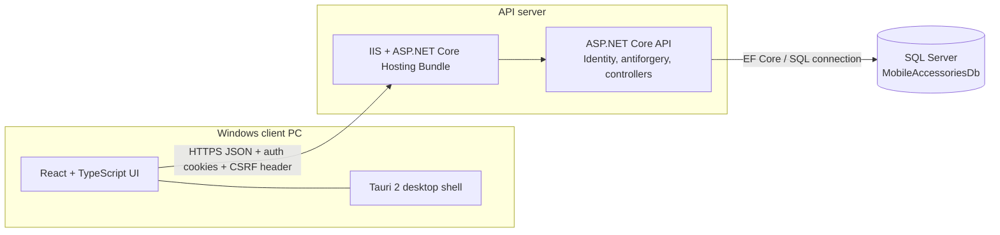

# Mobile Accessories Management

Windows desktop inventory and sales application backed by an ASP.NET Core API and SQL Server. The desktop client is a React/TypeScript application packaged with Tauri; it communicates with the API over HTTP(S), and the API is the only component that accesses the database.

> **Configuration note:** values such as server names, passwords, admin credentials, certificate thumbprints, and deployment paths are installation-specific. Configure them through environment variables or a private configuration provider. Do not commit secrets. The checked-in `appsettings.json` currently contains local bootstrap/database settings: review and replace those values before sharing or deploying this repository.

## Table of contents

- [Overview](#overview)
- [Features and modules](#features-and-modules)
- [Technology stack](#technology-stack)
- [Architecture](#architecture)
- [Repository structure](#repository-structure)
- [Prerequisites](#prerequisites)
- [Development setup](#development-setup)
- [Configuration](#configuration)
- [Authentication and security](#authentication-and-security)
- [Database](#database)
- [API reference](#api-reference)
- [Build and publish](#build-and-publish)
- [Production deployment on Windows IIS](#production-deployment-on-windows-iis)
- [Troubleshooting](#troubleshooting)
- [Implemented scope and notes](#implemented-scope-and-notes)

## Overview

The application provides product and category catalog management, stock receipts, invoice creation, and user administration. It supports barcode assignment and printing from the desktop interface. Invoice creation reduces inventory and records stock movements in the same database transaction.

The repository contains one .NET API project in `MobileAccessoriesManagement.slnx` and one Tauri desktop frontend. No automated test project, API documentation document, deployment script, or production `appsettings.Production.json` is present in the inspected tree.

## Features and modules

| Module | Implemented functionality | API | Access |
|---|---|---|---|
| Sign-in and session | CSRF token acquisition, email/password sign-in, current-user lookup, sign-out | `AuthController` | CSRF and login are anonymous; current user and logout require sign-in |
| Product catalog | Paged/searchable product listing, lookup by ID/barcode, create/update, activate/deactivate, generate barcode | `ProductsController` | Signed-in users can read; Admin can mutate or generate barcode |
| Categories | Paged search, inactive filtering, detail lookup, create/update, activate/deactivate | `CategoriesController` | Signed-in users can read; Admin can mutate |
| Stock receiving | Add quantity to active products and record a reason/audit movement | `StockController` | Admin only |
| Invoices | Search/list/detail and invoice creation; validates available stock, snapshots product details/prices, reduces stock, writes movement records | `InvoicesController` | Signed-in users |
| User administration | Create a user with a temporary password and retrieve a user summary | `UsersController` | Admin only |
| Barcode labels | Client-side label/printing interface using JsBarcode; generated/assigned barcode operations use product API | `BarcodeLabelPrinting` component and `ProductBarcodeGenerator` | Label UI requires signed-in product access; barcode generation is Admin only |

There is also a template `WeatherForecastController` at `GET /WeatherForecast`; it is not a business module. It does not carry `[AllowAnonymous]`, so the API fallback policy requires authentication for it.

## Technology stack

Versions below are the versions declared in project manifests, not necessarily the latest available releases.

| Area | Technology |
|---|---|
| API | ASP.NET Core / .NET `net10.0`, C# nullable references and implicit usings |
| Identity and persistence | ASP.NET Core Identity EF Core and Entity Framework Core SQL Server `10.0.14` |
| API OpenAPI | `Microsoft.AspNetCore.OpenApi` `10.0.14`; OpenAPI route is enabled only in Development |
| Desktop UI | React and React DOM `19.3.1`, TypeScript `~7.0.2`, Vite `^8.3.6` |
| Desktop shell | Tauri `2.12.5` (Rust crate), Tauri CLI `^2.12.4`; Rust edition 2024 and minimum Rust `1.90` |
| Barcode display | `jsbarcode` `^3.12.3` |
| Web server | Windows IIS with ASP.NET Core Module (deployment target described here; no IIS configuration is checked in) |
| Database | Microsoft SQL Server (EF Core provider) |

## Architecture

The desktop webview sends credentialed JSON requests to the ASP.NET Core API. In development, Vite proxies `/api` to the API process. In a packaged Tauri build the frontend uses the value embedded in `VITE_API_BASE_URL`; Vite's development proxy is not part of the installed application. The API uses `AppDbContext` and EF Core to access SQL Server.



Tauri does not contain an API server or database. Installers contain the desktop frontend and shell only; API and SQL Server remain separately hosted.

## Repository structure

```text
MobileAccessoriesManagement/
├── MobileAccessoriesManagement.slnx
├── README.md
├── README-Setup-Guide-MobileAccessories.md
├── Database/                         # Present; no tracked deployment/database scripts found
├── Deployment/                       # Present; no tracked deployment scripts found
├── Documentation/                    # Present; no tracked documentation files found
└── src/
    ├── Server/
    │   └── MobileAccessories.Api/
    │       ├── Controllers/          # Auth, categories, invoices, products, stock, users
    │       ├── Data/                 # AppDbContext and Identity bootstrap seeder
    │       ├── DTOs/                 # Request/response contracts
    │       ├── Migrations/           # EF Core schema history and model snapshot
    │       ├── Models/               # AppUser, Category, Product, Invoice, InvoiceLine, StockMovement
    │       ├── Security/              # Admin/User role constants
    │       ├── Services/              # Product barcode generation
    │       ├── Program.cs             # DI, middleware, auth, CORS, antiforgery
    │       ├── appsettings.json       # Base settings; replace local values and keep secrets private
    │       ├── appsettings.Development.json
    │       └── MobileAccessories.Api.csproj
    └── Client/
        └── MobileAccessories.Desktop/
            ├── src/api/               # Fetch wrapper and typed API calls
            ├── src/components/        # Login, catalog, invoices, user admin, barcode UI
            ├── src/App.tsx             # Application composition
            ├── src-tauri/              # Rust entry point, capabilities, bundle configuration
            ├── .env.development        # Vite development URL/proxy values
            ├── .env.production         # API URL embedded by production frontend build
            ├── package.json
            └── vite.config.ts
```

`dist`, `bin`, `obj`, `node_modules`, and `src-tauri/target` are generated build outputs and should not be treated as source structure.

## Prerequisites

- Windows 10/11 for the documented Tauri Windows installer and IIS deployment.
- .NET 10 SDK (the API targets `net10.0`). Confirm with `dotnet --list-sdks`.
- Node.js and npm compatible with Vite 8 (Node.js 20.19+ or 22.12+ is required by Vite 8). Confirm with `node --version` and `npm --version`.
- Rust stable toolchain 1.90 or later and Cargo (`rustup`, `rustc --version`, `cargo --version`).
- Tauri Windows build prerequisites: Microsoft C++ Build Tools with MSVC and the Windows 10/11 SDK. WebView2 Runtime is needed on client PCs when not already installed/managed by Windows.
- SQL Server instance reachable from the API host. SQL Server Express is suitable for local development; ensure TCP/IP/instance discovery and firewall configuration match the chosen connection string.
- EF CLI: `dotnet tool install --global dotnet-ef --version 10.0.14` (or update the global tool to that version).

## Development setup

### 1. Clone and restore

```powershell
git clone <repository-url> MobileAccessoriesManagement
Set-Location MobileAccessoriesManagement
dotnet restore .\MobileAccessoriesManagement.slnx
Set-Location .\src\Client\MobileAccessories.Desktop
npm ci
```

### 2. Configure the API

Set the connection string and initial Admin credentials in a private configuration source, such as .NET user secrets from the API directory:

```powershell
Set-Location ..\..\Server\MobileAccessories.Api
dotnet user-secrets init
dotnet user-secrets set "ConnectionStrings:DefaultConnection" "Server=<SQL-SERVER>;Database=MobileAccessoriesDb;User Id=<USER>;Password=<PASSWORD>;Encrypt=True;TrustServerCertificate=True;"
dotnet user-secrets set "BootstrapAdmin:Email" "<ADMIN-EMAIL>"
dotnet user-secrets set "BootstrapAdmin:Password" "<STRONG-UNIQUE-PASSWORD>"
```

The connection string example uses SQL authentication placeholders. For Windows integrated authentication, use `Integrated Security=True` and grant the API process identity database permissions. `TrustServerCertificate=True` is a development convenience; production SQL encryption should validate the server certificate.

The API reads `ConnectionStrings:DefaultConnection`, `BootstrapAdmin:Email`, `BootstrapAdmin:Password`, and optionally `Cors:AllowedOrigins`. The default launch profiles bind HTTP at `http://localhost:5039` and HTTPS at `https://localhost:7051` (also HTTP 5039). Trust the local ASP.NET HTTPS development certificate when prompted:

```powershell
dotnet dev-certs https --trust
```

### 3. Create/update the database

From `src/Server/MobileAccessories.Api`:

```powershell
dotnet ef database update
```

Existing migrations are included under `Migrations/`. To add a migration after changing entities, run:

```powershell
dotnet ef migrations add <MigrationName>
dotnet ef database update
```

The Identity seeder creates `Admin` and `User` roles at API startup. It creates the initial Admin only when one is not already present and both bootstrap settings are provided. The `Uncategorized` category is seeded through the EF model. No automatic `Database.Migrate()` call is present in API startup; apply migrations explicitly before starting a fresh environment.

### 4. Start the API

In one PowerShell window:

```powershell
Set-Location <repository>\src\Server\MobileAccessories.Api
dotnet run --launch-profile https
```

For the Vite proxy configuration as checked in (`http://localhost:5039`), use the `http` profile instead:

```powershell
dotnet run --launch-profile http
```

The Development OpenAPI document is available from the ASP.NET Core OpenAPI route mapped by `MapOpenApi` (typically `/openapi/v1.json`); it is not mapped in Production.

### 5. Start the desktop client

The checked-in `.env.development` points Vite to `/api` and proxies that path to `http://localhost:5039`. With the API running on that address:

```powershell
Set-Location <repository>\src\Client\MobileAccessories.Desktop
npm run dev
```

For the native Tauri window during development, run:

```powershell
npx tauri dev
```

The user interface has no separate React Router/application server; `src/App.tsx` composes the screens and `src/api/client.ts` performs HTTP calls with `credentials: 'include'`.

## Configuration

### Desktop environment files

Vite reads environment variables at build time and exposes `VITE_`-prefixed values to frontend code.

| File/key | Actual role |
|---|---|
| `.env.development` → `VITE_API_BASE_URL=/api` | Relative API path used by development frontend. |
| `.env.development` → `VITE_API_PROXY_TARGET=http://localhost:5039` | Required by `vite.config.ts` in development; the `/api` proxy forwards to this API origin. |
| `.env.production` → `VITE_API_BASE_URL=https://localhost:5043/api` | Current absolute API base URL compiled into production frontend assets. This is a local same-PC URL; replace it with the deployed API DNS name and HTTPS path before building an installer for client PCs. |
| `VITE_API_PROXY_TARGET` in production | Not used; Vite proxy configuration is created only when `mode === 'development'`. |

Changing `.env.production` after `npm run build` does not change an existing installer. Rebuild and redistribute the Tauri package. Never set the production URL to `localhost` when client machines differ from the API server.

### API settings

`appsettings.json` provides `ConnectionStrings:DefaultConnection`, `BootstrapAdmin:Email`, `BootstrapAdmin:Password`, logging, and `AllowedHosts`. `appsettings.Development.json` currently overrides logging only. No `appsettings.Production.json` exists in the repository. ASP.NET Core environment variables can override JSON, using double underscores:

```powershell
$env:ConnectionStrings__DefaultConnection = 'Server=<SQL-SERVER>;Database=MobileAccessoriesDb;Integrated Security=True;Encrypt=True;TrustServerCertificate=False;'
$env:BootstrapAdmin__Email = '<ADMIN-EMAIL>'
$env:BootstrapAdmin__Password = '<STRONG-UNIQUE-PASSWORD>'
$env:Cors__AllowedOrigins__0 = 'https://<CLIENT-ORIGIN>'
```

The CORS default allows `http://localhost:5173`, `tauri://localhost`, `http://tauri.localhost`, and `https://tauri.localhost`. If production Tauri requests report CORS errors, configure `Cors:AllowedOrigins` for the actual webview origin(s), with exact origins and no path component. CORS credential support requires explicit origins. The exact origin emitted by the packaged Tauri WebView should be confirmed on the target Windows/Tauri version before narrowing the allow list.

Use IIS environment variables, a protected machine-level configuration provider, or an appropriately secured deployment secret store for production secrets. Restrict access to deployment files and rotate any credential that has ever been committed or shared.

## Authentication and security

- ASP.NET Core Identity uses `AppUser` and `IdentityRole`, persisted by `AppDbContext`.
- Login uses `POST /api/auth/login` with `{ "email": "...", "password": "..." }`; successful sign-in issues an Identity authentication cookie. The sign-in is non-persistent, uses lockout on failure, and returns user ID, email, and roles. Failed login returns a generic `401` response.
- Password policy: minimum 12 characters, upper/lowercase, digit, non-alphanumeric character, and at least four unique characters. New users are locked after five failures for 15 minutes.
- Roles are exactly `Admin` and `User`. A fallback authorization policy requires an authenticated user for endpoints without `[AllowAnonymous]`. Admin-specific operations use role attributes. There are no named authorization policies in the source.
- `GET /api/auth/me` returns current identity/roles. `POST /api/auth/logout` signs out and requires authentication.
- Cookie is HttpOnly, path `/`, sliding expiration, and eight-hour lifetime. Development uses `MobileAccessories.Auth`, `SameSite=Lax`, and `SameAsRequest` secure policy. Non-development uses `__Host-MobileAccessories.Auth`, `SameSite=None`, and `Secure=Always`; the `__Host-` prefix requires HTTPS and path `/` with no Domain attribute.
- Antiforgery is globally applied through `AutoValidateAntiforgeryTokenAttribute`. The client first calls `GET /api/auth/csrf`, receives a request token and antiforgery cookie, then sends `X-CSRF-TOKEN` for unsafe requests. The antiforgery cookie is HttpOnly; production cookie is Secure and SameSite=None. Do not disable this validation or Secure cookies in production.
- The API redirects unauthorized/forbidden cookie challenges as JSON-friendly `401`/`403` statuses instead of HTML login redirects. `AddProblemDetails`, exception handling, and status-code pages are registered.
- HTTPS redirection is enabled. Use HTTPS end to end for production API access, with a trusted certificate whose Subject Alternative Name matches the host used by desktop clients.
- CORS is `ClientOrigins`, configured from `Cors:AllowedOrigins` or the development defaults, allowing credentials, methods, and headers. Do not use wildcard origins with credentialed cookies.

## Database

`AppDbContext : IdentityDbContext<AppUser>` maps Identity tables and these business tables:

| Entity/table concept | Relationships and important constraints |
|---|---|
| `Category` | One category has many products. Unique name, SQL Server `RowVersion`; seeded `Uncategorized` category. Category deletion is restricted while products reference it. |
| `Product` | Belongs to `Category`; unique filtered indexes on non-null `Barcode` and `Sku`; `RowVersion`; stock precision `(18,3)` and money precision `(18,2)`. |
| `Invoice` | Has many `InvoiceLine` records; unique invoice number; stores creator user ID/email and total. |
| `InvoiceLine` | Belongs to an invoice and references a product with delete restricted; snapshots product name, barcode, unit, quantity, unit price, and line total. Invoice deletion cascades to lines. |
| `StockMovement` | References a product and optionally an invoice; deletion of related product/invoice is restricted; indexed by product/time and invoice. Receipts and invoice sales write movements. |
| `AppUser` / Identity | ASP.NET Identity user and role tables; normalized email has a unique filtered index. |

Migrations currently present: `InitialCreate`, `ProductManagement`, `UserAuthentication`, `UniqueIdentityEmail`, `InvoiceCreation`, `StockMovements`, and `ProductSku`. Apply them with `dotnet ef database update` from the API project folder. The project uses SQL Server-specific rowversion and filtered indexes, so SQL Server is the supported provider reflected in the model.

Use a placeholder connection string and private credentials, for example:

```json
{
  "ConnectionStrings": {
    "DefaultConnection": "Server=<SQL-SERVER>;Database=MobileAccessoriesDb;Integrated Security=True;Encrypt=True;TrustServerCertificate=False;"
  }
}
```

For SQL authentication, replace integrated security with `User Id=<APP-USER>;Password=<SECRET>;` and store the secret outside source control. Grant the API identity only the database permissions it needs. The application does not connect to SQL Server from the desktop client.

## API reference

All endpoints use the `/api` prefix except the template weather endpoint. `[ApiController]` validation errors are returned as problem/validation details. Mutating endpoints require the antiforgery request header and authenticated cookie unless marked anonymous.

### Authentication (`AuthController`)

| Method | Endpoint | Purpose / body | Access |
|---|---|---|---|
| GET | `/api/auth/csrf` | Create/store antiforgery cookie; returns `CsrfTokenResponse` with `requestToken`. | Anonymous |
| POST | `/api/auth/login` | Sign in; `LoginRequest`: `email`, `password`; returns `UserSummaryResponse` (`id`, `email`, `roles`). | Anonymous + CSRF |
| GET | `/api/auth/me` | Current user summary. | Authenticated |
| POST | `/api/auth/logout` | Clear Identity session; `204` on success. | Authenticated + CSRF |

### Products (`ProductsController`)

| Method | Endpoint | Purpose / request | Access |
|---|---|---|---|
| GET | `/api/products?search=&page=1&pageSize=20&sortBy=name&sortDirection=asc&includeInactive=false` | Paged product response. Supports search, sort direction/field, active filtering. | Authenticated |
| GET | `/api/products/{id}` | Product detail. | Authenticated |
| GET | `/api/products/barcode/{barcode}` | Lookup by barcode. | Authenticated |
| POST | `/api/products` | Create `ProductRequest`; initial stock is set to zero. | Admin + CSRF |
| PUT | `/api/products/{id}` | Update `ProductRequest`, including current base64 `rowVersion`. | Admin + CSRF |
| POST | `/api/products/{id}/activate` | Activate product. | Admin + CSRF |
| POST | `/api/products/{id}/deactivate` | Deactivate product. | Admin + CSRF |
| POST | `/api/products/{id}/generate-barcode` | Generate/assign a barcode. | Admin + CSRF |

`ProductRequest` fields: `categoryId`, `name`, `brand`, `model`, `sku`, `hsnCode`, `barcode`, `unit`, `purchasePrice`, `salePrice`, `minimumStock`, `warrantyMonths`, `warrantyType`, and optional `rowVersion`. Product response includes identifiers, category, stock, active state, audit dates, and row version. Pagination response shape is `items`, `page`, `pageSize`, `totalCount`, `totalPages`.

### Categories (`CategoriesController`)

| Method | Endpoint | Purpose / request | Access |
|---|---|---|---|
| GET | `/api/categories?search=&page=1&pageSize=20&sortDirection=asc&includeInactive=false` | Paged category listing. Page size maximum is 100. | Authenticated |
| GET | `/api/categories/{id}` | Category detail including product count and `rowVersion`. | Authenticated |
| POST | `/api/categories` | Create `CategoryRequest` (`name`, optional `description`). | Admin + CSRF |
| PUT | `/api/categories/{id}` | Update category; send `name`, `description`, and current `rowVersion`. | Admin + CSRF |
| POST | `/api/categories/{id}/activate` | Activate category. | Admin + CSRF |
| POST | `/api/categories/{id}/deactivate` | Deactivate category; rejected if active products still use it. | Admin + CSRF |

### Stock (`StockController`)

| Method | Endpoint | Purpose / request | Access |
|---|---|---|---|
| POST | `/api/stock/products/{productId}/receipts` | Receive stock using `ReceiveStockRequest` (`quantity`, `reason`); returns product ID/name/current stock/unit. | Admin + CSRF |

### Invoices (`InvoicesController`)

| Method | Endpoint | Purpose / request | Access |
|---|---|---|---|
| GET | `/api/invoices?search=&page=1&pageSize=20` | Search/list invoice summaries. Page size maximum 100. | Authenticated |
| GET | `/api/invoices/{id}` | Invoice with line snapshots. | Authenticated |
| POST | `/api/invoices` | Create invoice using `CreateInvoiceRequest`: nullable `customerName`, `customerPhone`, `notes`; `lines` array of `{ productId, quantity }` (1–100 lines). | Authenticated + CSRF |

Invoice endpoint checks active product availability, stock, duplicate product lines, and at most three quantity decimal places. It uses the server's current sale prices and records a stock movement for each sale line.

### Users (`UsersController`)

| Method | Endpoint | Purpose / request | Access |
|---|---|---|---|
| POST | `/api/users` | Create user as role `User`; body `CreateUserRequest`: `email`, `temporaryPassword`. | Admin + CSRF |
| GET | `/api/users/{id}` | Retrieve user summary and roles. | Admin |

### Template endpoint

| Method | Endpoint | Purpose | Access |
|---|---|---|---|
| GET | `/WeatherForecast` | ASP.NET template sample forecast. | Authenticated (fallback policy) |

## Build and publish

Run commands from the repository root unless a working directory is shown.

### Restore and build API

```powershell
dotnet restore .\MobileAccessoriesManagement.slnx
dotnet build .\MobileAccessoriesManagement.slnx -c Release
```

### Migrations

```powershell
Set-Location .\src\Server\MobileAccessories.Api
dotnet ef migrations list
dotnet ef database update
```

### Publish API for IIS

```powershell
dotnet publish .\src\Server\MobileAccessories.Api\MobileAccessories.Api.csproj -c Release -o .\artifacts\api
```

This is framework-dependent by default. IIS hosting requires the matching ASP.NET Core Hosting Bundle on the server. Copy the contents of `artifacts\api` to a protected IIS application directory.

### Build frontend and Tauri installer

```powershell
Set-Location .\src\Client\MobileAccessories.Desktop
npm ci
npm run build
npx tauri build
```

`npm run build` runs `tsc -b && vite build`; the Tauri configuration runs this command before bundling. Windows bundles are written beneath `src-tauri\target\release\bundle\` (configured targets are `all`), typically `nsis\` and `msi\` subfolders. Exact filenames depend on `productName`, version, architecture, and Tauri bundler output. The checked-in configuration identifies the product as `Mobile Accessories` version `0.1.0`.

Before production build, set `.env.production`'s `VITE_API_BASE_URL` to `https://<API-DNS-NAME>[:port]/api`. This becomes part of built frontend assets.

## Production deployment on Windows IIS

The deployment model is: desktop client(s) → HTTPS API on IIS → SQL Server reachable from the API host. The repository does not include an IIS `web.config`, published artifact, binding configuration, or provisioning script; use the generated `web.config` from `dotnet publish` and substitute approved machine-specific names/paths below.

### 1. Prepare and publish the API

On a development/build machine:

```powershell
dotnet restore .\MobileAccessoriesManagement.slnx
dotnet publish .\src\Server\MobileAccessories.Api\MobileAccessories.Api.csproj -c Release -o .\artifacts\api
```

Copy `artifacts\api` to a directory such as `C:\inetpub\MobileAccessoriesApi`. Keep application files writable only by administrators/deployment automation; grant the application pool read/execute access. The app does not automatically apply migrations, so run `dotnet ef database update` from a controlled release workstation or deployment process before switching traffic.

### 2. Install IIS prerequisites

Install the IIS Web Server role and the ASP.NET Core Hosting Bundle matching the API's .NET 10 target on the server, then restart IIS after bundle installation:

```powershell
 iisreset
```

Install the current supported .NET 10 Hosting Bundle from Microsoft's official .NET downloads on the server. Confirm the installed runtime with `dotnet --list-runtimes`. A Hosting Bundle version must support the targeted runtime; do not assume the SDK is required on the production server.

### 3. Configure SQL connectivity and secrets

Allow outbound connectivity from the IIS host to the SQL Server TCP port and grant the API process identity database access. Set `ConnectionStrings__DefaultConnection`, `BootstrapAdmin__Email`, and `BootstrapAdmin__Password` as protected IIS application environment variables or through a managed secret provider. Do not store production secrets in source-controlled JSON or a broadly readable `web.config`.

If hosting SQL Server on another machine, enable the SQL Server network protocol/port and firewall rule there, use a stable server/instance DNS address, and validate TLS. If using Windows integrated security, grant the application pool identity or designated service account database access.

### 4. Create the application pool and site

Run elevated PowerShell on the IIS server; replace placeholders. These commands assume the WebAdministration module and a dedicated pool/site:

```powershell
Import-Module WebAdministration
New-WebAppPool -Name 'MobileAccessoriesApiPool'
Set-ItemProperty 'IIS:\AppPools\MobileAccessoriesApiPool' -Name managedRuntimeVersion -Value ''
New-Website -Name 'MobileAccessoriesApi' -PhysicalPath 'C:\inetpub\MobileAccessoriesApi' -Port 80 -HostHeader '<API-DNS-NAME>' -ApplicationPool 'MobileAccessoriesApiPool'
```

The API should be served over HTTPS. If port 80 is enabled for the hostname, configure it to redirect to HTTPS at the IIS/site or network edge. The IIS site should use the published folder as its physical path, and the pool should use **No Managed Code** because ASP.NET Core is hosted through the ASP.NET Core Module.

Grant read/execute to the pool identity (do not grant write access to the whole app folder unless a specific feature requires it):

```powershell
icacls 'C:\inetpub\MobileAccessoriesApi' /grant 'IIS AppPool\MobileAccessoriesApiPool:(OI)(CI)RX'
```

Configure production environment variables at the IIS application/site level or machine-level environment source, then recycle the application pool. Keep secrets in an access-controlled source.

### 5. Bind HTTPS and certificate

In IIS Manager, select the site → **Bindings** → **Add** → `https`, port `443` (or chosen port), host name `<API-DNS-NAME>`, and select a valid server certificate. The certificate must chain to a trusted authority and include the exact DNS name in its Subject Alternative Name. For internal networks, deploy a certificate from a trusted enterprise CA to client PCs. Do not ship private keys with the desktop installer.

The API enables HTTPS redirection. Ensure IIS HTTPS binding is configured correctly and the API is reached at the HTTPS URL. If using a non-default HTTPS port, publish that port in the URL and firewall.

### 6. Firewall and connectivity checks

Allow inbound TCP 443 (or the chosen HTTPS port) on the API server, and allow the API server to reach SQL Server's configured TCP port. Open only required ports and scope rules to the intended network where feasible.

From a client PC, verify name resolution and TLS/API response:

```powershell
Resolve-DnsName <API-DNS-NAME>
Test-NetConnection <API-DNS-NAME> -Port 443
Invoke-WebRequest 'https://<API-DNS-NAME>/openapi/v1.json' -UseBasicParsing
```

OpenAPI is mapped only in Development, so a `404` for `/openapi/v1.json` in Production is expected and does not prove the site is down. Check a known API path such as the CSRF route instead:

```powershell
Invoke-RestMethod 'https://<API-DNS-NAME>/api/auth/csrf'
```

Check IIS logs, Windows Event Viewer (Application), and ASP.NET Core stdout logs only when explicitly enabled and secured. Do not leave verbose/stdout logging enabled indefinitely in production.

### 7. Build/install the desktop client

On the build machine, set the production API base URL to the deployed HTTPS origin, then build:

```powershell
Set-Location .\src\Client\MobileAccessories.Desktop
# Edit .env.production so VITE_API_BASE_URL=https://<API-DNS-NAME>/api
npm ci
npx tauri build
```

Distribute the generated NSIS setup executable or MSI from `src-tauri\target\release\bundle\` through an approved channel. Install on each Windows client and test sign-in, CSRF-protected actions, CORS, and certificate trust. Every client needs network access to the API DNS name and must trust the server certificate chain.

### Same-PC versus separate-PC deployments

- **Same PC:** `https://localhost:<port>/api` can work when the API and desktop client run on the same computer and that PC trusts its development/issued certificate. Production still requires secure cookies and HTTPS.
- **Separate PCs:** `localhost` refers to each client PC itself, not the API host. Set `VITE_API_BASE_URL` to a DNS name or IP that resolves to the server, such as `https://shop-api.example.local/api`. The API certificate must contain and validate the exact DNS name (or IP SAN) used by the client; otherwise TLS validation fails. Prefer stable DNS with a trusted certificate over an IP address.

## Troubleshooting

| Symptom | Checks and actions |
|---|---|
| Desktop cannot connect to API | Confirm `VITE_API_BASE_URL` was set before the frontend build; check server name/port and `Test-NetConnection`; verify API is running and HTTPS is trusted. In dev, confirm API is listening at the `VITE_API_PROXY_TARGET` address and restart Vite after env changes. |
| Requests go to client `localhost` | Production bundle has localhost compiled in. Change `.env.production` to the API server DNS URL, then rerun `npm run build` / `npx tauri build` and reinstall. |
| IIS site stopped / 500.30 or 500.31 | Check site and pool state, Hosting Bundle/runtime installation, Event Viewer, application logs, published directory, and `web.config`. After installing Hosting Bundle run `iisreset`; recycle the app pool. |
| Application Pool errors | Confirm dedicated pool exists, **No Managed Code** is set, identity can read/execute the publish folder, and the IIS site points to the correct physical path. Check Windows Event Viewer for ANCM startup detail. |
| SQL connection failure | From API host verify SQL service/instance, TCP/IP, firewall/port, connection string, database exists, TLS certificate trust, and the IIS process identity/database permissions. Apply EF migrations before first use. |
| HTTP 401 | Login may have failed, cookie may be absent/expired, or client is not sending credentials. Confirm login result, `credentials: include`, correct API origin, HTTPS, cookie policy, and that `GET /api/auth/me` works after login. |
| HTTP 403 | The user is authenticated but lacks the required role; stock, user administration, product writes, category writes, and barcode generation require `Admin`. |
| CSRF/antiforgery 400 | Fetch a fresh `GET /api/auth/csrf` token and cookie, send `X-CSRF-TOKEN` on POST/PUT, preserve credentials, and avoid switching hostnames/origins mid-session. The client clears its cached request token after a protected 400. |
| CORS error | Configure exact `Cors:AllowedOrigins` origins, including scheme and port, for the deployed Tauri origin; restart API. Credentials cannot be paired with wildcard origins. Distinguish a browser CORS message from a server/TLS/network failure. |
| HTTPS certificate warning | Ensure the client trusts the issuing CA, certificate is current, and SAN matches the exact DNS host used in `VITE_API_BASE_URL`. Do not disable certificate validation in production. |
| Installer build failure | Confirm Node/npm, Rust 1.90+, MSVC C++ tools, Windows SDK, and WebView2 prerequisites; run `npm ci`, `npm run build`, then `npx tauri build` from the desktop folder. Inspect the first failing command in output. |

Useful diagnostics:

```powershell
dotnet --info
dotnet --list-runtimes
dotnet ef migrations list --project .\src\Server\MobileAccessories.Api\MobileAccessories.Api.csproj
node --version
npm --version
rustc --version
cargo --version
Get-Service W3SVC
Get-WebAppPoolState -Name 'MobileAccessoriesApiPool'
Get-Website -Name 'MobileAccessoriesApi'
Test-NetConnection <API-DNS-NAME> -Port 443
```

## Implemented scope and notes

The source implements the modules and routes listed above. It does not currently implement a mobile client, supplier/purchase-order module, returns/refunds, reporting dashboard/export, inventory adjustment history browsing, or password-reset UI/API. These are not described as existing features here. `WeatherForecastController` is retained from the API template. Repository-level automated tests were not found during inspection.

There is no checked-in `appsettings.Production.json`; production CORS, SQL connection, bootstrap credentials, HTTPS binding, certificate, IIS paths, and allowed origins must be supplied for each deployment. The README's example server names and paths are placeholders and require local confirmation.
